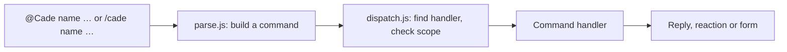

# Cade

**C.A.D.E.**, the Central Assistant for Delivery & Execution, is a Slack
app for tracking a team's work as tasks in its own channel. A group can
also have a channel shared with a client, where the client starts
requirements and reports incidents that the team tracks as tasks. It runs as a single
Cloudflare Worker, with its tasks in a D1 database.

- **Start here:** [the Cade website](https://xteclk.github.io/Cade/)
  shows what it does, [how to set it up](https://xteclk.github.io/Cade/setup.html)
  with an AI agent, and [every command](https://xteclk.github.io/Cade/commands.html).
- [GETTING_STARTED.md](GETTING_STARTED.md) is the step-by-step setup the
  agent follows, if you'd rather follow it yourself.
- This page is for working on the code.

## Development

```sh
npm install
npm test        # the whole suite, in a few seconds, without Slack
npm run dev     # the Worker on this machine
npm run deploy  # the Worker on Cloudflare
```

`npm run dev` serves the Worker at `http://localhost:8787`, reloading as you
edit. It takes the channels, time zone and Sheet address from
`cade.config.json`, and asks for the secrets each time without saving them
(or takes them from the environment, such as `SLACK_BOT_TOKEN=… npm run
dev`). Slack can't reach `localhost`, so to try it against Slack, expose it
with a tunnel (such as `cloudflared tunnel --url http://localhost:8787`) and
create a separate app for it: `npm run slack:create -- <tunnel URL> --name
"Cade Dev" --command /cadedev`. Deploying to a pair of test channels is
often simpler.

Other scripts:

| Script | Does |
| --- | --- |
| `npm run setup` | Starts Claude Code with `scripts/setup-prompt.md`, to be taken through the setup |
| `npm run group -- --name acme --tasks C… [--external C…] [--incidents C…] [--doc new\|<address>] [--sheet new\|<address>]` | Adds or changes a group in `cade.config.json` and uploads it; `new` makes the group's doc or spreadsheet through its web app |
| `npm run config` | Checks `cade.config.json` and uploads it as Worker secrets (`CHANNEL_PAIRS`, `TIMEZONE`, `GOOGLE_URL`) |
| `npm run db:migrate` | Applies `migrations/` to the deployed D1 database; `npm run deploy` does this after deploying, and `npm run dev` for the local one |
| `npm run slack:create -- <url>` | Creates the Slack app from `slack/manifest.json` |
| `npm run slack:update` | Applies `slack/manifest.json` to the app created above |
| `npm run google:create` | Creates the Google web app (each group's Sheet and Doc) with clasp, and gives the Worker its address and secret |
| `npm run google:update` | Pushes `google/` and redeploys it to the same address |

## How it works

Slack sends three kinds of request to the Worker:

| Path | Slack feature | Handles |
| --- | --- | --- |
| `/slack/events` | Event Subscriptions | Messages: `@Cade …` commands, and plain messages Cade reacts to |
| `/slack/interactions` | Interactivity | Forms, buttons and menus |
| `/slack/commands` | Slash Commands | `/cade …` |

Every request is checked against the signing secret first. Slack wants an
answer within three seconds, so slow work runs after the response, through
`waitUntil`.

Most commands are messages that start by mentioning the bot, such as
`@Cade assign @person`, because Slack doesn't allow custom slash commands in
threads and most commands are sent from a thread. Commands that start
something new outside a thread are slash commands, which can open a form
straight away.



Plain messages aren't commands, but some still mean something: a pasted PR
link, a hand-off such as "@rex please look into this", "okay, started
working on this", or "LGTM". These are **intents**. A handler declares its
intents next to its commands, each with the phrases (or a test) that signal
it, what it needs (a thread, a mention), an `order`, and what to do;
`src/intents.js` picks the first that matches. Today there are:

| Order | Intent | In | Signals |
| --- | --- | --- | --- |
| 10 | `pr-link` | `pr.js` | a pull request link, in a task's thread or a tracked requirement's |
| 20, 30 | `hand-off:reviewer`, `hand-off:tester` | `assign.js` (`HANDOFFS`) | someone mentioned, asked to review or test |
| 38 | `started:reported` | `assign.js` (`REPORTED`) | someone mentioned, said to have started |
| 40 | `hand-off:developer` | `assign.js` (`HANDOFFS`) | someone mentioned, asked to work on it, or to take it over |
| 45 | `started` | `assign.js` (`STARTED`) | the writer saying they, or the team, have started |
| 46 | `progress` | `status.js` | "LGTM", "QA passed", "done", "merged" |
| 50 | `new-thread` | `move.js` | a message posted on its own, not in a thread |

Each only asks the writer, privately, before changing anything, since a
phrase can match a message that didn't mean it. Questions ("done?") and
hedged messages ("not done yet") don't count as progress. In a requirement's
thread, the team's suggestions only go to members of the pair's tasks or
incidents channel, since Slack can't otherwise tell the team from the
client.

### Where things are kept

Tasks and requirements are stored in D1, the `DB` binding (`db.js`, with
the tables in `migrations/`). A new one is stored before its root message is
posted (`createTask` in `commands/track.js`, `createRequirement` in
`commands/requirement.js`), with `ts` empty until Slack takes the post; if
Slack refuses it, the cron in `wrangler.toml` posts it again every five
minutes (`retry.js`, through `publishTask` and `publishRequirement`), up to
five tries in all. Once posted, a row is found by its channel and `ts`.
`loadTask` and `saveTask` in `tasks.js` read and write a
task; `saveTask` stores the row first, then renders it to the root message
in the dev channel (`taskMessage`) and to its row in the Google Sheet
(`syncTask`). A requirement or incident works the same way in the external
channel (`requirements.js`). Slack and the Sheet are only written to, never
read back: `/cade tasks` is a query of open tasks. A task with
`source_channel` set was tracked from a requirement or incident thread; the
team's own tasks have none. A requirement task's PRs sent to the client
with `@Cade release` are rows of `releases`, one per release, with its PRs
and what it completes; a task is loaded with them (`getTask`), and its
message and its requirement's show which PRs shipped with which release.
Deleted tasks and requirements keep their rows,
with `deleted_at` set. Open tasks and requirements are still pinned, for
people to find in Slack.

The database isn't named in `wrangler.toml`, so nothing account-specific is
committed: the first `wrangler deploy` creates one for the Worker, named
after it (`<name>-db`), and later deploys reuse it. To change the tables, add
a numbered file to `migrations/`; `npm run deploy` applies it.

### Files

| File | Role |
| --- | --- |
| `src/index.js` | Routes, signature check, posting replies and reactions |
| `src/commands/parse.js` | Turns a message or slash command into a command |
| `src/commands/dispatch.js` | Finds the handler, checks where it may run, runs it, builds help |
| `src/commands/registry.js` | The list of handlers, and the handler shape |
| `src/commands/*.js` | One module per command: `track`, `requirement` (and `incident`), `assign`, `unassign`, `status`, `details` (`priority`, `due`), `pr`, `release`, `detach`, `tasks`, `standup`, `delete`, `summary`, `export`, `import` |
| `src/db.js` | Reading and writing tasks and requirements in D1 |
| `src/retry.js` | The cron's job: posting tasks and requirements Slack refused |
| `src/tasks.js` | The task message: layout, saving, the Sheet row, pins |
| `src/requirements.js` | The requirement message, and finding a thread's task or requirement |
| `src/channels.js` | `CHANNEL_PAIRS`: which channel plays which role |
| `src/intents.js` | Recognising intents in plain messages |
| `src/slack.js` | Calling Slack, Block Kit helpers, acknowledgements |
| `src/google.js` | Calling the Google web app |
| `src/sheet.js` | Writing rows to each group's Google Sheet |
| `src/doc.js` | Writing executive summaries to each group's Google Doc, and reading them back |
| `google/` | The Google web app's Apps Script (`Code.gs`, `Sheet.gs`, `Doc.gs`, `appsscript.json`), and its uncommitted `Secret.gs` |
| `scripts/` | `config`, `dev`, `group`, `slack-app` and `google-app`, behind the npm scripts above |
| `migrations/` | The D1 tables, applied in order by `wrangler d1 migrations apply` |
| `slack/manifest.json` | The Slack app: scopes, events, URLs, the slash command |
| `test/index.test.js` | The tests, with `test/d1.js`, a stand-in database on Node's SQLite |

### Adding a command

Create a module in `src/commands/` and add it to the list in
`src/commands/registry.js`, whose comment describes the handler shape. A
handler declares its name, how it's used, its help section, and where it may
run (which channels, and whether only in a thread); the dispatcher enforces
these and answers with a hint when a command is used in the wrong place.
Its buttons and forms are registered on the same handler, as `actions` (by
action ID) and `views` (by form callback ID), and so are any `intents`:
to recognise a new kind of message, add an `intent({ … })` to a handler's
`intents` (the comment at the top of `src/intents.js` has the shape), or add
words to an existing list such as `HANDOFFS`. If it needs a new Slack scope
or event, add it to `slack/manifest.json` and run `npm run slack:update`.

## Tests

`npm test` runs `test/index.test.js` against the real Worker, with `fetch`
replaced by a fake Slack API: `mockSlack` returns canned results and records
every call, so tests check exactly what Cade would send. Like Slack, the
fake rejects a message whose buttons share an action ID. Shared fixtures,
such as `rootMessage` (a task from a requirement), `ownTask` (the team's own
task), `requirementRoot` and `incidentRoot`, build the messages Slack would
return.
