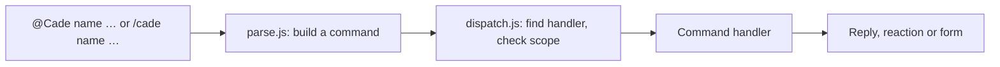

# Cade

**C.A.D.E.**, the Central Assistant for Delivery & Execution, is a Slack
app for tracking work between a client and a team: the client starts
requirements and reports incidents in a shared channel, and
the team tracks them as tasks in its own channels. It runs as a single
Cloudflare Worker, with no database.

- To set Cade up, configure it and learn its commands, see
  [GETTING_STARTED.md](GETTING_STARTED.md).
- This page is for working on the code.

## Development

```sh
npm install
npm test        # the whole suite, in a few seconds, without Slack
npm run dev     # the Worker on this machine
npm run deploy  # the Worker on Cloudflare
```

`npm run dev` serves the Worker at `http://localhost:8787`, reloading as you
edit. It takes the channels, time zone and Sheet address from
`cade.config.json`, and asks for the secrets each time without saving them
(or takes them from the environment, such as `SLACK_BOT_TOKEN=… npm run
dev`). Slack can't reach `localhost`, so to try it against Slack, expose it
with a tunnel (such as `cloudflared tunnel --url http://localhost:8787`) and
create a separate app for it: `npm run slack:create -- <tunnel URL> --name
"Cade Dev" --command /cadedev`. Deploying to a pair of test channels is
often simpler.

Other scripts:

| Script | Does |
| --- | --- |
| `npm run config` | Checks `cade.config.json` and uploads it as Worker secrets (`CHANNEL_PAIRS`, `TIMEZONE`, `SHEET_URL`) |
| `npm run slack:create -- <url>` | Creates the Slack app from `slack/manifest.json` |
| `npm run slack:update` | Applies `slack/manifest.json` to the app created above |
| `npm run sheet:create` | Creates the Google Sheet and its web app with clasp, and gives the Worker its address and secret |
| `npm run sheet:update` | Pushes `google-sheet/Code.gs` and redeploys it to the same address |

## How it works

Slack sends three kinds of request to the Worker:

| Path | Slack feature | Handles |
| --- | --- | --- |
| `/slack/events` | Event Subscriptions | Messages: `@Cade …` commands, and plain messages Cade reacts to |
| `/slack/interactions` | Interactivity | Forms, buttons and menus |
| `/slack/commands` | Slash Commands | `/cade …` |

Every request is checked against the signing secret first. Slack wants an
answer within three seconds, so slow work runs after the response, through
`waitUntil`.

Most commands are messages that start by mentioning the bot, such as
`@Cade assign @person`, because Slack doesn't allow custom slash commands in
threads and most commands are sent from a thread. Commands that start
something new outside a thread are slash commands, which can open a form
straight away.



Plain messages aren't commands, but some still mean something: a pasted PR
link, or a hand-off such as "@rex please look into this". These are
**intents**. A handler declares its intents next to its commands, each with
the phrases (or a test) that signal it, what it needs (a thread, a
mention), an `order`, and what to do; `src/intents.js` picks the first that
matches. Today there are four: `pr-link` in `pr.js`, then
`hand-off:reviewer`, `hand-off:tester` and `hand-off:developer` in
`assign.js`, whose phrases are in `HANDOFFS`. Each only asks the writer,
privately, before changing anything, since a phrase can match a message
that didn't mean it.

### Where things are kept

There is no database. A task lives in its root message in the dev channel:
its details are the message's metadata (`cade_task`), read back with
`loadTask` and written with `saveTask` in `tasks.js`. A requirement or
incident lives the same way in its root message in the external channel
(`cade_requirement`, in `requirements.js`). Open tasks and requirements are
pinned, and Cade unpins them when they're Done, so `/cade tasks` reads only
pins. The Google Sheet, if set, is a record kept alongside (`sheet.js`,
`google-sheet/Code.gs`), never read back.

### Files

| File | Role |
| --- | --- |
| `src/index.js` | Routes, signature check, posting replies and reactions |
| `src/commands/parse.js` | Turns a message or slash command into a command |
| `src/commands/dispatch.js` | Finds the handler, checks where it may run, runs it, builds help |
| `src/commands/registry.js` | The list of handlers, and the handler shape |
| `src/commands/*.js` | One module per command: `track`, `requirement` (and `incident`), `assign`, `unassign`, `status`, `details` (`priority`, `due`), `pr`, `tasks`, `delete` |
| `src/tasks.js` | The task message: layout, metadata, saving, pins |
| `src/requirements.js` | The requirement message, and finding a thread's task or requirement |
| `src/channels.js` | `CHANNEL_PAIRS`: which channel plays which role |
| `src/intents.js` | Recognising intents in plain messages |
| `src/slack.js` | Calling Slack, Block Kit helpers, acknowledgements |
| `src/sheet.js` | Writing rows to the Google Sheet |
| `google-sheet/` | The Sheet's Apps Script (`Code.gs`, `appsscript.json`), and its uncommitted `Secret.gs` |
| `scripts/` | `config`, `dev`, `slack-app` and `sheet-app`, behind the npm scripts above |
| `slack/manifest.json` | The Slack app: scopes, events, URLs, the slash command |
| `test/index.test.js` | The tests |

### Adding a command

Create a module in `src/commands/` and add it to the list in
`src/commands/registry.js`, whose comment describes the handler shape. A
handler declares its name, how it's used, its help section, and where it may
run (which channels, and whether only in a thread); the dispatcher enforces
these and answers with a hint when a command is used in the wrong place.
Its buttons and forms are registered on the same handler, as `actions` (by
action ID) and `views` (by form callback ID), and so are any `intents`:
to recognise a new kind of message, add an `intent({ … })` to a handler's
`intents` (the comment at the top of `src/intents.js` has the shape), or add
words to an existing list such as `HANDOFFS`. If it needs a new Slack scope
or event, add it to `slack/manifest.json` and run `npm run slack:update`.

## Tests

`npm test` runs `test/index.test.js` against the real Worker, with `fetch`
replaced by a fake Slack API: `mockSlack` returns canned results and records
every call, so tests check exactly what Cade would send. Like Slack, the
fake rejects a message whose buttons share an action ID. Shared fixtures,
such as `rootMessage` (a task from a requirement), `ownTask` (the team's own
task), `requirementRoot` and `incidentRoot`, build the messages Slack would
return.
