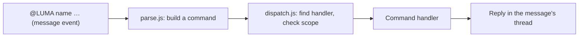

# project-helper

Helper workflows for project management and requirement summarize, running as
the `project-helper` Cloudflare Worker behind the Luma Slack app.

## How commands are handled

Most commands are messages that start by @mentioning the bot, such as
`@LUMA assign @person`. Slack doesn't allow custom slash commands in threads,
and most commands are sent from a thread. Messages that don't start with
`@LUMA` are ignored. Starting something new outside a thread uses the slash
commands `/luma requirement` (external channel) and `/luma track` (dev
channel), which open their form straight away since a slash command, unlike
a message, can open one.



| File | Role |
| --- | --- |
| `src/index.js` | HTTP routes, Slack signature check, posts replies |
| `src/commands/parse.js` | Turns an `@LUMA …` message or `/luma …` slash command into a command |
| `src/commands/dispatch.js` | Looks up the handler, checks where it may run, runs it |
| `src/commands/registry.js` | The list of command handlers |
| `src/commands/track.js`, `requirement.js`, `assign.js`, `unassign.js`, `status.js`, `details.js` (priority, due), `delete.js` | Command handlers |
| `src/tasks.js` | Task message layout and storage, shared by the handlers |
| `src/requirements.js` | Requirement message layout and storage, and finding a requirement's task |
| `src/sheet.js`, `google-sheet/Code.gs` | Records tasks in a Google Sheet |

A handler declares its name, usage, and where it may run: which channel, and
whether it must be sent in a thread. The dispatcher enforces these, so a
command used in the wrong place gets a hint such as "Use `@LUMA assign
@person` in a task thread in #aura300-dev". `@LUMA help`, a bare `@LUMA` or
an unknown command replies with the command list. To add a command, create a
module in `src/commands/` and add it to `src/commands/registry.js`. Its
comment describes the handler shape.

Buttons, menus and the task form are handled by the same modules: a handler
can register `actions` (by action ID) and `views` (by modal callback ID).

| Path | Slack feature |
| --- | --- |
| `/slack/events` | Event Subscriptions (`@LUMA` messages) |
| `/slack/interactions` | Interactivity (forms, buttons, menus) |
| `/slack/commands` | Slash Commands (`/luma requirement`, `/luma incident`, `/luma track`) |

## Task tracker commands

Each channel has one way to track a task:

- **Client work:** start it with **`/luma requirement`** in
  `#aura300-external` (see [Requirements](#requirements)), then send
  **`@LUMA track`** in the requirement's thread. `@LUMA track` works only
  there; anywhere else Luma explains where to use it. A requirement has one
  task, so a tracked requirement can't be tracked again.
- **The team's own work:** send **`/luma track`** in `#aura300-dev`. It
  opens a form for the **task title**, an optional **due date** (picked from
  a calendar and shown as DD/MM/YYYY) and the **priority** (Urgent, High,
  Medium, Low). The task has no external thread, so it shows only "Tracked
  by @you", and status changes and deletion are not shared anywhere else.

Either way, Luma posts the task to `#aura300-dev` and pins it. The task
message shows the title; then the status, priority and due date; then the
developer, reviewer and tester ("Unassigned" until someone is assigned);
then who tracked it, with a link back to the requirement thread if there is
one. From a requirement thread, Luma replies with a **Track task** button
(Slack only opens forms from a click) and turns it into "@you tracked a
task: *title*", linking to the new task.

Tasks tracked from ordinary external threads before this change keep
working: their status changes can still be shared with that thread.

### Requirements

**`/luma requirement`** in `#aura300-external` opens the same form as a
task: the requirement's **name**, an optional **due date** and the
**priority**. Luma then posts it as a new message to discuss in its thread. The
message shows:

1. "**Requirement:**" and the requirement name, so it can be told apart from
   incidents in the same channel,
2. its status, priority and due date, and
3. in small text, who started it and who tracked it, linking to the task
   thread ("Not tracked yet" until there is one), the same way a task
   links back to its requirement thread.

The message always shows the current status, priority and due date. Who
changes what follows who knows it:

- **Priority and due date are the client's.** They are changed only in the
  requirement's thread, with `@LUMA priority` and `@LUMA due` (below),
  before and after a task is tracked. Once there is a task, the task
  changes with them and Luma notes the change in the task's thread for the
  team. In the task's thread Luma refuses to change them and links to the
  requirement thread.
- **Status is the team's.** It is changed only in `#aura300-dev`, with
  `@LUMA status`. The requirement shows it as the client sees it: **In
  discussion** until a task is tracked, then 🔵 **In progress** while the
  task is To do, In progress, In review or In testing, then **Client
  review** and **Done**. **Inform external thread** only decides whether a
  message is also posted in the requirement thread.
- **The client can accept work, if the team asks.** The team can set a task
  to Done directly. Client review is an optional step for work the client
  should check first: when the dev channel moves a requirement's task to
  Client review, Luma posts in the requirement thread straight away,
  without asking whether to inform it, mentioning whoever started the
  requirement so they are notified, with **Approve** and
  **Not approve** buttons. **Approve** moves the task to Done; **Not
  approve** moves it back to In progress, and the client explains what
  needs to change in the thread. Either way Luma tells the task's thread in
  `#aura300-dev`. The buttons do nothing once the team has moved the task
  on, and Slack can't tell the team from the client, so anyone in the
  external channel can click them.

When it's agreed, send **`@LUMA track`** in the requirement's thread. The
form asks only for the task title, starting with the requirement's name, and
shows the priority and due date the task will take from the requirement.
The requirement then links to the task. Deleting the task puts the
requirement back to In discussion, keeping its priority and due date.

To remove a requirement, send **`@LUMA remove`** (or `@LUMA delete`) in its
thread. It asks for confirmation the same way as deleting a task, then
deletes the requirement message and Luma's replies. A tracked requirement
can't be removed: untrack it first with `@LUMA remove` in the task's thread
in `#aura300-dev`, and Luma's reply links there.

Assign and unassign are for tasks only, and only tracked tasks are recorded
in the Google Sheet.

### Incidents

Incidents come in through the external channel too, but are tracked in the
pair's own incidents channel (set `incidents` in `CHANNEL_PAIRS`).

**`/luma incident`** in `#aura300-external` opens a form that asks only what
the incident is. Incidents are always 🔴 **Urgent** and due **Immediate**,
and need no discussion first, so on submit Luma:

1. posts "**Incident:** *title*" in the external channel, like a
   requirement message but "Reported by" whoever reported it, and
2. tracks it straight away as a task in the incidents channel, pinned, and
   links the two, so the incident shows 🔵 In progress.

From then on it works like a tracked requirement: the task commands below
work in the incidents channel, the incident message always shows the
current status, and Client review asks the reporter to approve. The only
difference is that an incident's priority and due date can't be changed,
in either thread. Incident tasks are recorded in the pair's sheet tab with
the other tasks.

### Task commands

In a task's thread in `#aura300-dev` or the incidents channel:

- `@LUMA assign developer @person [@person …]` adds people as developers;
  `@LUMA assign reviewer @person` and `@LUMA assign tester @person` work the
  same way. Each role can have several people.
- `@LUMA unassign developer @person` removes people from that role;
  `@LUMA unassign @person` removes them from every role.
- `@LUMA status` replies with a menu of statuses (To do, In progress, In
  review, In testing, Client review, Done), starting at the current one.
  Picking one updates the task and replaces the menu with a confirmation.
  You can also skip the menu with `@LUMA status done` or
  `@LUMA status in progress`. New tasks start as `TODO`. Setting `DONE`
  unpins the task; moving it from `DONE` to any other status pins it again,
  so the channel's pins list shows the open tasks. A requirement or
  incident is pinned in the external channel the same way: from when it is
  posted until its task is Done, and again if the task is reopened or
  deleted. When a task moves from an
  open status (To do, In progress, In review, In testing) to Client review
  or Done, the confirmation asks whether to tell the external thread the
  task was tracked from: **Inform external thread** posts "@you marked a
  task as Done: *title*" there, linking back to the task; **I'll tell them**
  posts nothing. Moving between Client review and Done doesn't ask again.
- `@LUMA priority high` changes the priority (Urgent, High, Medium, Low);
  `@LUMA priority` replies with a menu. `@LUMA due 30/11/2026` changes the
  due date (YYYY-MM-DD also works), `@LUMA due none` removes it, and
  `@LUMA due` replies with a date picker. These work in the thread of a
  requirement, and in the thread of a task with no requirement. For a task
  tracked from a requirement, they are changed in the requirement thread
  instead (see [Requirements](#requirements)).
- `@LUMA delete` (or `@LUMA remove`) replies with a prominent **Cancel**
  button and a plain **Delete task** button. **Delete task** opens a second "Delete task?" dialog,
  and only the person who sent `@LUMA delete` can confirm or cancel. Once
  confirmed, Luma deletes the task message and all of its own replies in the
  thread, which also removes the pin. Slack only lets a bot delete its own
  messages, so people's replies stay in the thread under a "This message was
  deleted" placeholder. Luma then posts "@you untracked a task: *title*"
  in the external thread the task was tracked from.

Each command updates the root message and Luma confirms in the thread. The
mention works whatever the bot is named.

The task's details are stored as Slack message metadata on the root message,
so the Worker needs no database.

### Google Sheet

Slack's free plan only keeps recent history, so every task is also recorded
in a Google Sheet, with one tab per channel pair (for example **aura300** and
**test**). Filter the Status column to see completed tasks. See
[google-sheet/README.md](google-sheet/README.md) for the setup. Without
`SHEET_URL` and `SHEET_SECRET`, syncing is turned off.

### Channels

`CHANNEL_PAIRS` in `wrangler.toml` links each external channel to the channel
its tasks are posted to. Several pairs can run at once, so a pair of test
channels can sit alongside `#aura300-external` → `#aura300-dev`: tracking
from the test external channel creates tasks in the test tasks channel, and
the thread commands work in either tasks channel.

## Setup

See [SLACK_SETUP.md](SLACK_SETUP.md) for the Slack app settings, Worker
secrets and channel IDs, plus a checklist to confirm everything works.

## Development

```sh
npm install
npm test
npm run dev
```

`npm run dev` serves the Worker locally. To try it against Slack, expose it
with a tunnel and point the app's Interactivity, Events and Slash Command
request URLs at the tunnel.

## GitHub Actions deployment

The **Deploy to Cloudflare Workers** workflow runs on every push to `main` and
can also be started manually from the **Actions** tab. It installs
dependencies, runs the tests, and runs `wrangler deploy`.

In GitHub, open **Settings → Secrets and variables → Actions**. Add
`CLOUDFLARE_API_TOKEN` as a repository secret and `CLOUDFLARE_ACCOUNT_ID` as a
repository variable. The token needs **Account → Workers Scripts → Edit**
permission. The workflow does not set the Slack secrets; set those with
`wrangler secret put`.
