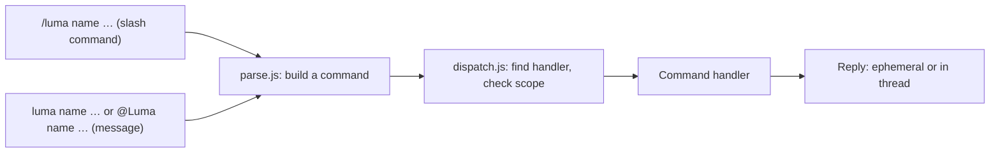

# project-helper

Helper workflows for project management and requirement summarize, running as
the `project-helper` Cloudflare Worker behind the Luma Slack app.

## How commands are handled

Every Slack request goes through the same pipeline:



| File | Role |
| --- | --- |
| `src/index.js` | HTTP routes, Slack signature check, delivers replies |
| `src/commands/parse.js` | Turns a slash command or a message into one command shape |
| `src/commands/dispatch.js` | Looks up the handler, checks where it may run, runs it |
| `src/commands/registry.js` | The list of command handlers |
| `src/commands/track.js`, `assign.js`, `unassign.js`, `status.js`, `delete.js` | One handler per command |
| `src/tasks.js` | Task message layout and storage, shared by the handlers |

A handler declares its name, usage, and where it may run: slash command or
message, which channel, and whether it must be sent in a thread. The
dispatcher enforces these, so a command used in the wrong place gets a hint
such as "Use `luma assign @person` in a task thread in #aura300-dev". To add
a command, create a module in `src/commands/` and add it to
`src/commands/registry.js`. Its comment describes the handler shape.

Messages that start with `luma` but name no known command are ignored, so
normal conversation doesn't trigger replies. `@Luma <unknown>` and `/luma`
alone reply with the command list.

| Path | Slack feature |
| --- | --- |
| `/slack/commands` | Slash command `/luma` |
| `/slack/interactions` | Interactivity (modals and buttons) |
| `/slack/events` | Event Subscriptions (messages) |

## Task tracker commands

**`/luma track`** (in `#aura300-external`) opens a form for the **task
title**, an optional **due date** (`MM/DD`) and the **priority** (Urgent,
High, Medium, Low). On submit, Luma:

1. posts the task to `#aura300-dev` with its status, title, priority, due
   date and assignees, and pins it to the channel, and
2. announces "@you tracked a task: *title*" in `#aura300-external`, linking to
   the new thread.

Slack doesn't allow custom slash commands in threads. To track a task from a
thread in `#aura300-external`, reply **`luma track`** there. Luma answers with
a **Track task** button that opens the same form. After you submit, that
reply becomes the announcement, so the link stays in the thread.

In a task's thread in `#aura300-dev`:

- `luma assign @person [@person …]` adds people to the task.
- `luma unassign @person [@person …]` removes them.
- `luma status` replies with a menu of statuses (To do, In progress, In
  review, In testing, Client review, Done), starting at the current one.
  Picking one updates the task and replaces the menu with a confirmation.
  You can also skip the menu with `luma status done` or
  `luma status in progress`. New tasks start as `TODO`. Setting
  `DONE` unpins the task; moving it from `DONE` to any other status pins it
  again, so the channel's pins list shows the open tasks.
- `luma delete` (or `luma remove`) replies with **Delete task** and
  **Cancel** buttons. **Delete task** opens a second "Delete task?" dialog,
  and only the person who sent `luma delete` can confirm or cancel. Once
  confirmed, Luma deletes the task message and all of its own replies in the
  thread, which also removes the pin. Slack only lets a bot delete its own messages, so people's
  replies stay in the thread under a "This message was deleted" placeholder.
  The announcement in `#aura300-external` stays, but its link will no longer
  open the task.

You can also @mention the bot instead of typing `luma`, for example
`@Luma assign @person`; this works whatever the bot is named. Luma updates the root message and
confirms in the thread. Thread commands start with `luma`, not `/luma`,
because Slack treats any message that starts with `/` as a slash command.

The task's details are stored as Slack message metadata on the root message,
so the Worker needs no database.

## Setup

See [SLACK_SETUP.md](SLACK_SETUP.md) for the Slack app settings, Worker
secrets and channel IDs, plus a checklist to confirm everything works.

## Development

```sh
npm install
npm test
npm run dev
```

`npm run dev` serves the Worker locally. To try it against Slack, expose it
with a tunnel and point the app's request URLs at the tunnel.

## GitHub Actions deployment

The **Deploy to Cloudflare Workers** workflow runs on every push to `main` and
can also be started manually from the **Actions** tab. It installs
dependencies, runs the tests, and runs `wrangler deploy`.

In GitHub, open **Settings → Secrets and variables → Actions**. Add
`CLOUDFLARE_API_TOKEN` as a repository secret and `CLOUDFLARE_ACCOUNT_ID` as a
repository variable. The token needs **Account → Workers Scripts → Edit**
permission. The workflow does not set the Slack secrets; set those with
`wrangler secret put`.
