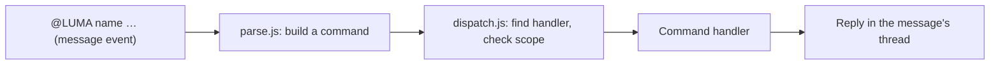

# project-helper

Helper workflows for project management and requirement summarize, running as
the `project-helper` Cloudflare Worker behind the Luma Slack app.

## How commands are handled

Every command is a message that starts by @mentioning the bot, such as
`@LUMA assign @person`. Slack doesn't allow custom slash commands in threads,
and most commands are sent from a task's thread, so all commands work the
same way. Messages that don't start with `@LUMA` are ignored.



| File | Role |
| --- | --- |
| `src/index.js` | HTTP routes, Slack signature check, posts replies |
| `src/commands/parse.js` | Turns an `@LUMA …` message into a command |
| `src/commands/dispatch.js` | Looks up the handler, checks where it may run, runs it |
| `src/commands/registry.js` | The list of command handlers |
| `src/commands/track.js`, `assign.js`, `unassign.js`, `status.js`, `delete.js` | One handler per command |
| `src/tasks.js` | Task message layout and storage, shared by the handlers |

A handler declares its name, usage, and where it may run: which channel, and
whether it must be sent in a thread. The dispatcher enforces these, so a
command used in the wrong place gets a hint such as "Use `@LUMA assign
@person` in a task thread in #aura300-dev". `@LUMA help`, a bare `@LUMA` or
an unknown command replies with the command list. To add a command, create a
module in `src/commands/` and add it to `src/commands/registry.js`. Its
comment describes the handler shape.

Buttons, menus and the task form are handled by the same modules: a handler
can register `actions` (by action ID) and `views` (by modal callback ID).

| Path | Slack feature |
| --- | --- |
| `/slack/events` | Event Subscriptions (`@LUMA` messages) |
| `/slack/interactions` | Interactivity (task form, buttons, status menu) |

## Task tracker commands

**`@LUMA track`** in `#aura300-external`, usually as a reply in the thread
where the request was discussed. Luma replies with a **Track task** button;
Slack only opens forms from a click. The form asks for the **task title**, an
optional **due date** (picked from a calendar and shown as DD/MM/YYYY) and the **priority** (Urgent, High, Medium,
Low). On submit, Luma:

1. posts the task to `#aura300-dev` and pins it to the channel. The task
   message shows the title; then the status, priority and due date; then the
   developer, reviewer and tester ("Unassigned" until someone is assigned);
   then who tracked it, with a link back to the request thread, and
2. replaces the button with "@you tracked a task: *title*", linking to the
   new task thread.

For the team's own work that has no request thread, send **`@LUMA track`**
in `#aura300-dev` itself. The same button and form create the task in that
channel. Such a task has no external thread, so it shows only "Tracked by
@you", and status changes and deletion are not shared anywhere else.

In a task's thread in `#aura300-dev`:

- `@LUMA assign developer @person [@person …]` adds people as developers;
  `@LUMA assign reviewer @person` and `@LUMA assign tester @person` work the
  same way. Each role can have several people.
- `@LUMA unassign developer @person` removes people from that role;
  `@LUMA unassign @person` removes them from every role.
- `@LUMA status` replies with a menu of statuses (To do, In progress, In
  review, In testing, Client review, Done), starting at the current one.
  Picking one updates the task and replaces the menu with a confirmation.
  You can also skip the menu with `@LUMA status done` or
  `@LUMA status in progress`. New tasks start as `TODO`. Setting `DONE`
  unpins the task; moving it from `DONE` to any other status pins it again,
  so the channel's pins list shows the open tasks. When a task moves from an
  open status (To do, In progress, In review, In testing) to Client review
  or Done, the confirmation asks whether to tell the external thread the
  task was tracked from: **Inform external thread** posts "@you marked a
  task as Done: *title*" there, linking back to the task; **I'll tell them**
  posts nothing. Moving between Client review and Done doesn't ask again.
- `@LUMA delete` (or `@LUMA remove`) replies with **Delete task** and
  **Cancel** buttons. **Delete task** opens a second "Delete task?" dialog,
  and only the person who sent `@LUMA delete` can confirm or cancel. Once
  confirmed, Luma deletes the task message and all of its own replies in the
  thread, which also removes the pin. Slack only lets a bot delete its own
  messages, so people's replies stay in the thread under a "This message was
  deleted" placeholder. Luma then posts "@you untracked a task: *title*"
  in the external thread the task was tracked from.

Each command updates the root message and Luma confirms in the thread. The
mention works whatever the bot is named.

The task's details are stored as Slack message metadata on the root message,
so the Worker needs no database.

### Channels

`CHANNEL_PAIRS` in `wrangler.toml` links each external channel to the channel
its tasks are posted to. Several pairs can run at once, so a pair of test
channels can sit alongside `#aura300-external` → `#aura300-dev`: tracking
from the test external channel creates tasks in the test tasks channel, and
the thread commands work in either tasks channel.

## Setup

See [SLACK_SETUP.md](SLACK_SETUP.md) for the Slack app settings, Worker
secrets and channel IDs, plus a checklist to confirm everything works.

## Development

```sh
npm install
npm test
npm run dev
```

`npm run dev` serves the Worker locally. To try it against Slack, expose it
with a tunnel and point the app's Interactivity and Events request URLs at the tunnel.

## GitHub Actions deployment

The **Deploy to Cloudflare Workers** workflow runs on every push to `main` and
can also be started manually from the **Actions** tab. It installs
dependencies, runs the tests, and runs `wrangler deploy`.

In GitHub, open **Settings → Secrets and variables → Actions**. Add
`CLOUDFLARE_API_TOKEN` as a repository secret and `CLOUDFLARE_ACCOUNT_ID` as a
repository variable. The token needs **Account → Workers Scripts → Edit**
permission. The workflow does not set the Slack secrets; set those with
`wrangler secret put`.
